

# Nazar Mykhailyshchuk

**Software Engineer | Full-Stack & Backend**

Next.js/TypeScript, Python, Spring Boot, Rust, PostgreSQL · UCU CS '28 · open to junior roles

I build full-stack web apps backed by a real database, often with an LLM somewhere in the pipeline. Lately I also build my own: a self-hosted learning platform in Rust and a small model that autocompletes terminal commands. Most of the rest started as a course project or a hackathon and ended up deployed. I also mentor two first-year teams on algorithms and data-structure projects.

🟢 **Open to junior roles**

[Featured](#featured) · [University](#university) · [Hackathons](#hackathons)

🟢 live: a real product in use · 🟢 demo: runs on sample data · ⚪ no site, code only

-----

## Featured

Start here.

<table>
<tr>
<td width="50%" valign="top">
<a href="https://vumlo.partum55.me">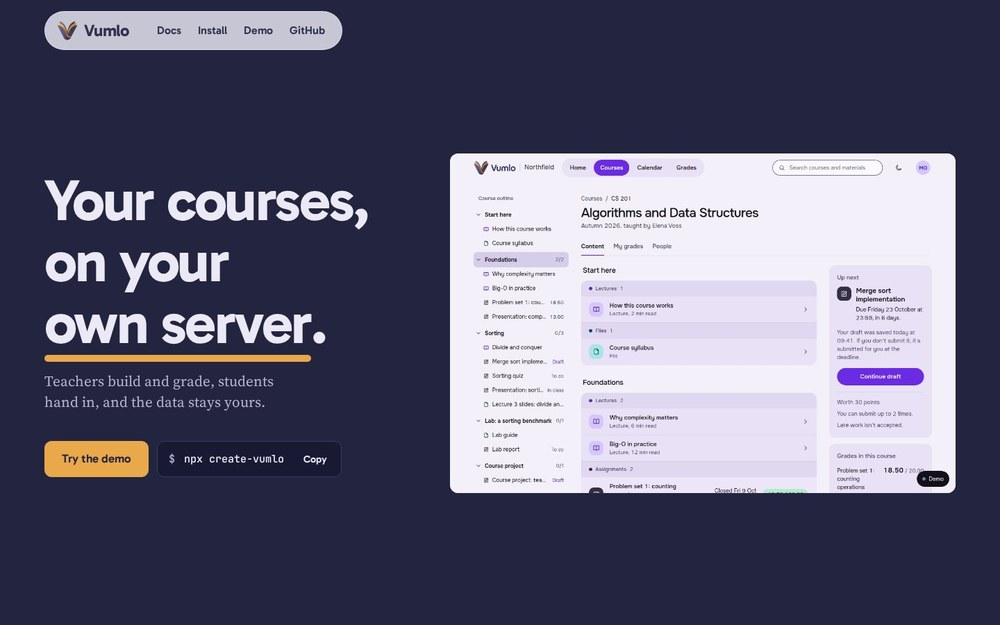</a>
<h3><a href="https://vumlo.partum55.me">Vumlo</a></h3>
🟢 Demo · open source (MIT) 
<a href="https://vumlo.partum55.me">Website</a> · <a href="https://vumlo-demo.partum55.me">Live demo (sample data)</a> · <a href="https://github.com/Vumlo/vumlo-core">Code</a>

A self-hosted learning platform that one school or university runs on its own server, written in Rust. Teachers build courses and grade work next to the student’s answer; students hand in text, files, quizzes and forms; a gradebook shows every grade. Groups and rosters, password or Google sign-in, and an optional offline desktop app. Successor to my earlier <a href="https://github.com/partum55/LearnSystem">LearnSystem</a> (Spring Boot + React microservices, code only).

<code>Rust</code> <code>PostgreSQL</code> <code>Next.js</code> <code>Tauri</code> <code>Docker</code>
</td>
<td width="50%" valign="top">
<a href="https://ucusnack.app">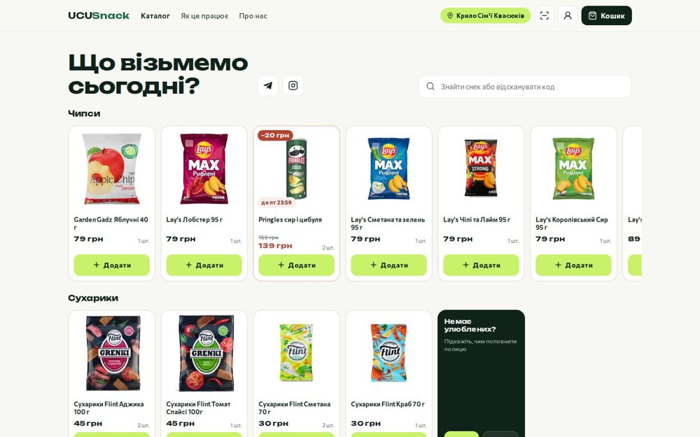</a>
<h3><a href="https://ucusnack.app">UCUSnack</a></h3>
🟢 Live · team of 3 · just launching 
<a href="https://ucusnack.app">Live</a>

Online shop for a self-service micro-market in a university dormitory: catalog with search, a cart, a barcode scanner and online payment through Monobank. My part: the staff and admin back office (products, stock per dormitory wing, coupons, orders, stock log) and hardening of the payment flow.

<code>Next.js</code> <code>Supabase</code> <code>Monobank</code>
</td>
</tr>
<tr>
<td width="50%" valign="top">
<a href="https://vartovimrii.vercel.app">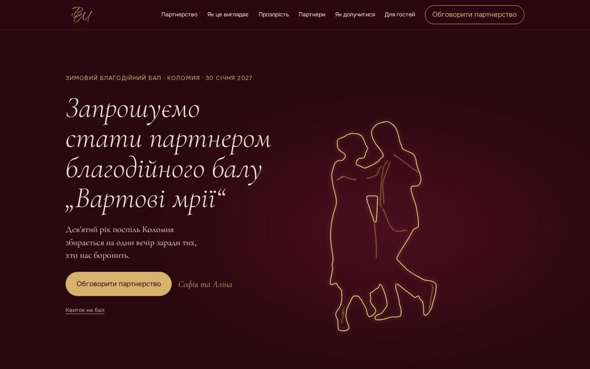</a>
<h3><a href="https://vartovimrii.vercel.app">Вартові мрії (Vartovi Mrii)</a></h3>
🟢 Live · charity ball in Kolomyia · I’m on the organizing team 
<a href="https://vartovimrii.vercel.app">Live</a>

I built the sponsor landing site, with scroll-driven animation, and a separate admin panel that issues QR e-tickets, which are scanned at the entrance.

<code>Astro</code> <code>GSAP</code> <code>Next.js</code> <code>Supabase</code>
</td>
<td width="50%" valign="top">
<a href="https://www.silpoparty.app">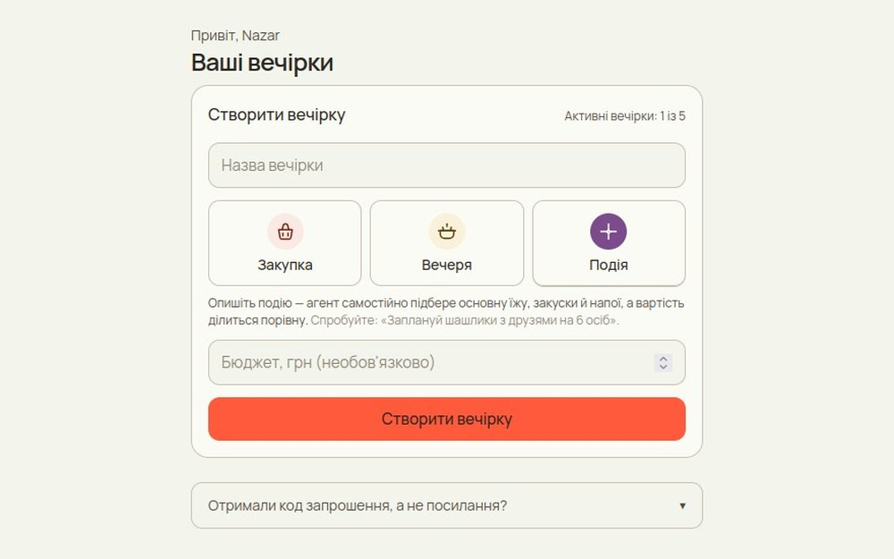</a>
<h3><a href="https://www.silpoparty.app">Silpo Party</a></h3>
🟢 Demo · team of 4 
<a href="https://www.silpoparty.app">Live demo</a> · <a href="https://github.com/partum55/silpo_party">Code</a>

AI that turns a group chat into a ready-to-buy basket from the live catalog of Silpo, a Ukrainian supermarket chain. Food restrictions and budget respected, cost split fairly, one-click handoff to the host’s real Silpo cart. The live site is a demo with scripted replies; the full app, with real AI and the Silpo catalog, is in the code.

<code>Next.js</code> <code>TypeScript</code> <code>Supabase</code> <code>AI SDK</code> <code>MCP</code>
</td>
</tr>
<tr>
<td width="50%" valign="top">
<a href="https://github.com/partum55/terllm">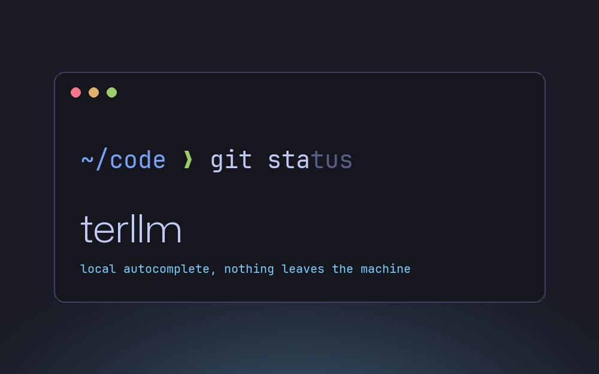</a>
<h3><a href="https://github.com/partum55/terllm">terllm</a></h3>
⚪ Open source · MIT 
<a href="https://github.com/partum55/terllm">Code</a> · <a href="https://huggingface.co/partum/terllm">Model on Hugging Face</a>

A tiny local model that autocompletes terminal commands. A 135M-parameter model fine-tuned on synthetic shell sessions suggests the rest of a command as ghost text in zsh and bash. It looks at the current folder, git state and recent commands, runs on the CPU as a native C++ daemon, nothing leaves the machine, and it installs as a <code>.deb</code> (Debian/Ubuntu, x86-64).

<code>C++</code> <code>Python</code> <code>llama.cpp</code> <code>SmolLM2</code> <code>Modal</code>
</td>
<td width="50%" valign="top"></td>
</tr>
</table>

-----

## University

Course and research team projects at the Ukrainian Catholic University.

<table>
<tr>
<td width="50%" valign="top">
<a href="https://15x4.partum55.me">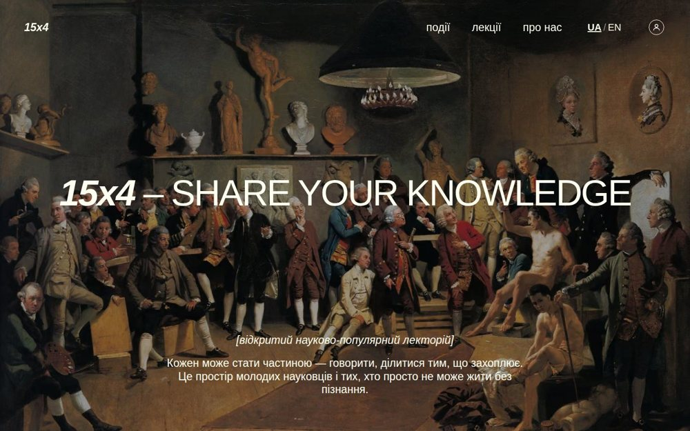</a>
<h3><a href="https://15x4.partum55.me">15x4</a></h3>
🟢 Demo · team of 4 · I wrote most of the code 
<a href="https://15x4.partum55.me">Live demo</a> · <a href="https://github.com/partum55/15x4">Code</a>

Platform for a public lecture community: email-confirmation sign-up, an admin moderation dashboard, a bilingual (UA/EN) interface and AI-powered content translation. The live site is a demo on sample data with a built-in test admin; the real version runs on Supabase.

<code>Next.js</code> <code>React</code> <code>TypeScript</code> <code>Supabase</code>
</td>
<td width="50%" valign="top">
<a href="https://github.com/partum55/vio">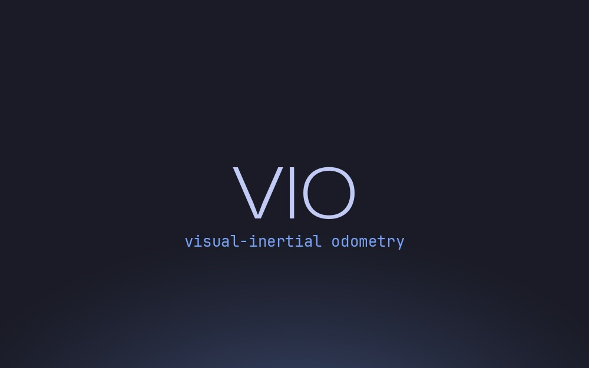</a>
<h3><a href="https://github.com/partum55/vio">VIO</a></h3>
⚪ Code only · course team project · finished 
<a href="https://github.com/partum55/vio">Code</a>

Visual-inertial odometry in C++: estimates how a camera moves from video and motion-sensor data. Reads EuRoC dataset sequences, detects and tracks features, estimates the camera pose (PnP + RANSAC), triangulates 3D points and filters IMU data, with an optional OpenCL-accelerated tracker and live Rerun visualization.

<code>C++20</code> <code>OpenCV</code> <code>Eigen</code> <code>OpenCL</code> <code>Rerun</code>
</td>
</tr>
<tr>
<td width="50%" valign="top">
<a href="https://github.com/partum55/SemEval-RETECO">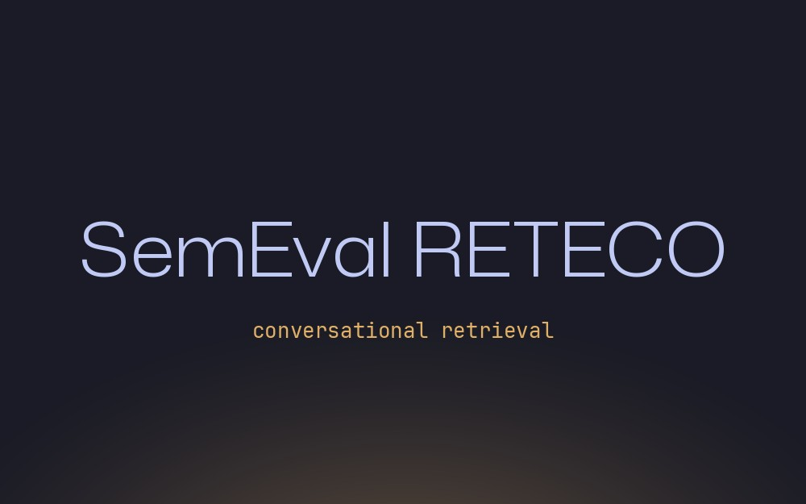</a>
<h3><a href="https://github.com/partum55/SemEval-RETECO">SemEval RETECO</a></h3>
⚪ In progress · UCU AI course team project 
<a href="https://github.com/partum55/SemEval-RETECO">Code</a>

Our entry in SemEval-2027 RETECO, the conversational-retrieval track, where a system has to find the right documents for a conversation even when that takes reasoning. BM25 and dense baselines calibrated against the organisers’ numbers, rank fusion tuned per domain, LLM query rewriting and reranking, scored with nDCG@10.

<code>Python</code> <code>BM25</code> <code>sentence-transformers</code> <code>FAISS</code> <code>Modal</code>
</td>
<td width="50%" valign="top">
<a href="https://github.com/partum55/vepryk6plus">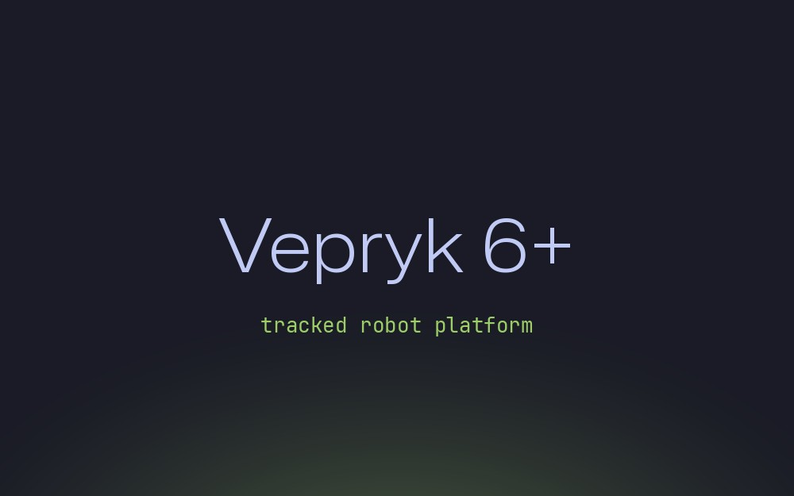</a>
<h3><a href="https://github.com/partum55/vepryk6plus">Vepryk 6+</a></h3>
⚪ Code only · course team project · I built it with my team 
<a href="https://github.com/partum55/vepryk6plus">Code</a>

Remote control and vision for a tracked robot platform. My team and I built a joystick-driven desktop app with live video and telemetry that sends MAVLink commands over an SSH tunnel to a Raspberry Pi, which drives an ESP32 motor controller. It also has a mode that follows an AprilTag marker with a PID controller.

<code>C++</code> <code>Python</code> <code>Qt</code> <code>MAVLink</code> <code>Raspberry Pi</code> <code>ESP32</code>
</td>
</tr>
</table>

-----

## Hackathons

Team builds, made under time pressure.

<table>
<tr>
<td width="50%" valign="top">
<a href="https://hirely.partum55.me">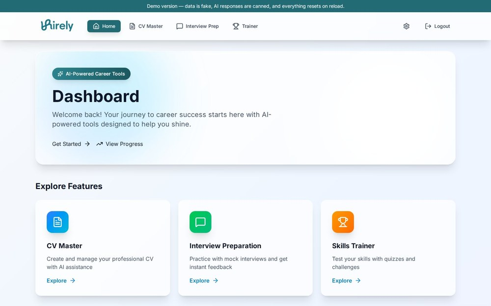</a>
<h3><a href="https://hirely.partum55.me">Hirely</a></h3>
🟢 Demo · team of 3 · I’m the primary developer 
<a href="https://hirely.partum55.me">Live demo</a> · <a href="https://github.com/partum55/hirely">Code</a>

AI career assistant: a CV builder, an AI mock-interview simulator and a skills trainer, in English and Ukrainian. The live site runs on sample data with canned AI replies.

<code>React</code> <code>Django</code> <code>Groq API</code>
</td>
<td width="50%" valign="top">
<a href="https://github.com/partum55/planly">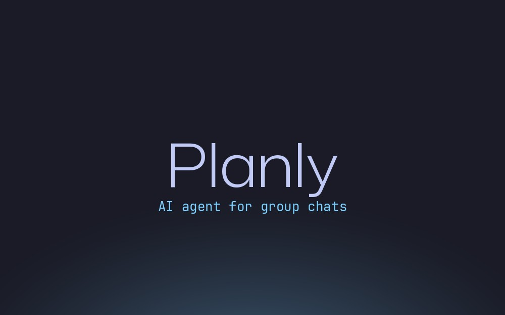</a>
<h3><a href="https://github.com/partum55/planly">Planly</a></h3>
⚪ Prototype · not deployed 
<a href="https://github.com/partum55/planly">Code</a>

AI agent for group chats. Reads Telegram groups, or any chat app through screenshots, and turns plans like “dinner on Friday” into calendar events and venue suggestions. The model runs through Ollama (Llama 3.1).

<code>Python</code> <code>FastAPI</code> <code>Ollama</code> <code>Llama 3.1</code> <code>Telegram API</code> <code>Google Calendar</code> <code>Supabase</code>
</td>
</tr>
</table>

-----

## Tools I reach for

Plus Groq API, AI SDK, MCP and llama.cpp on the AI side. Currently going deeper on systems architecture.

-----

 

 

