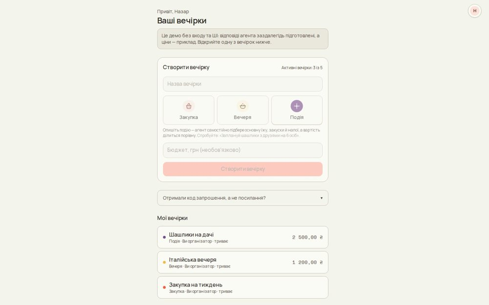
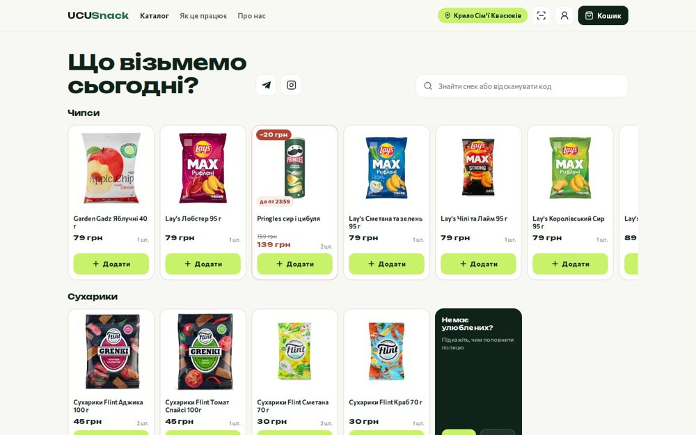
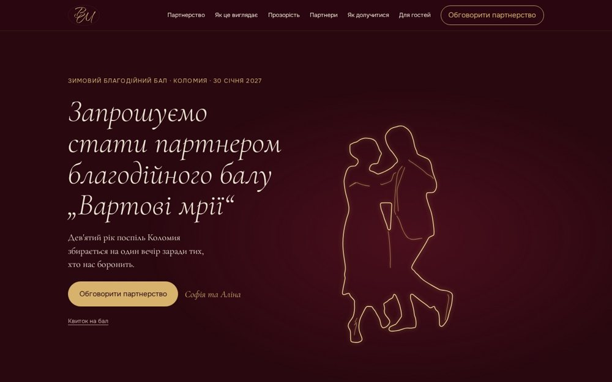
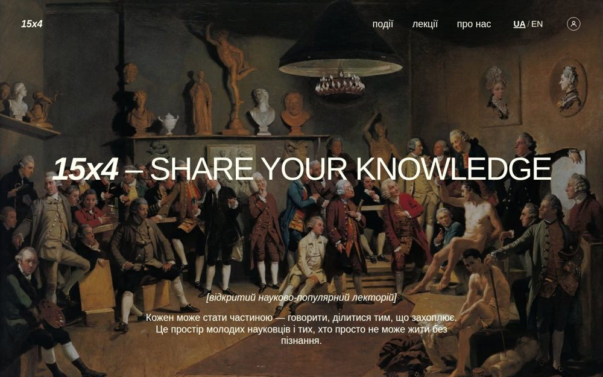

# Nazar Mykhailyshchuk

**Full-stack developer · Computer Science student at the Ukrainian Catholic University, Lviv**

I build full-stack web apps, usually Next.js or Spring Boot in front of a real database, often with an LLM somewhere in the pipeline. Most of what’s here started as a course project or a hackathon and ended up deployed. I also mentor first-year students on algorithms and data-structure projects.

-----

## Things I’ve shipped

<table>
<tr>
<td width="50%" valign="top">

<h3><a href="https://www.silpoparty.app">Silpo Party</a></h3>
Hackathon · team of 2 · <a href="https://www.silpoparty.app">live demo</a> · <a href="https://github.com/partum55/silpo_party">code</a>

AI that turns a group chat into a ready-to-buy basket from the live catalog of Silpo, a Ukrainian supermarket chain. Food restrictions and budget respected, cost split fairly, one-click handoff to the host’s real Silpo cart. The live site is a demo with scripted replies; the full app is in the code.

<code>Next.js</code> <code>TypeScript</code> <code>Supabase</code> <code>AI SDK</code> <code>MCP</code>
</td>
<td width="50%" valign="top">

<h3><a href="https://ucusnack.app">UCUSnack</a></h3>
Team of 3 · just launching · <a href="https://ucusnack.app">live</a>

Online shop for a self-service micro-market in a university dormitory: catalog with search, a cart, a barcode scanner and online payment through Monobank. My part: the staff and admin back office (products, stock per dormitory wing, coupons, orders) and hardening of the payment flow.

<code>Next.js</code> <code>Supabase</code> <code>Monobank</code>
</td>
</tr>
<tr>
<td width="50%" valign="top">

<h3><a href="https://vartovimrii.vercel.app">Вартові мрії (Vartovi Mrii)</a></h3>
Charity ball in Kolomyia · I’m on the organizing team · <a href="https://vartovimrii.vercel.app">live</a>

A sponsor landing site with scroll-driven animation, plus an admin panel that issues QR e-tickets scanned at the entrance.

<code>Astro</code> <code>GSAP</code> <code>Next.js</code> <code>Supabase</code>
</td>
<td width="50%" valign="top">

<h3><a href="https://15x4.vercel.app">15x4</a></h3>
Public lecture community · <a href="https://15x4.vercel.app">live</a> · <a href="https://github.com/partum55/15x4">code</a>

Multi-role platform: email-confirmation auth, an admin moderation dashboard, a bilingual (UA/EN) interface, and AI-powered content translation.

<code>Next.js</code> <code>React</code> <code>TypeScript</code> <code>Supabase</code>
</td>
</tr>
</table>

-----

## Open source and research

<b>Vumlo</b> — self-hosted learning platform for a school or university <i>(open source, MIT)</i>

 

[Code](https://github.com/Vumlo/vumlo-core) · [UCU deployment](https://vumlo-ucu.vercel.app) (opens on a sign-in screen, university accounts only)

`Rust` `PostgreSQL` `Next.js` `Tauri` `Docker`

Courses, groups, assignments with quizzes and forms, a gradebook, password or Google sign-in and an optional offline desktop app. It succeeds my earlier [LearnSystem](https://github.com/partum55/LearnSystem), a Spring Boot and React version on microservices.

<b>terllm</b> — a tiny local model that autocompletes terminal commands

 

[Code](https://github.com/partum55/terllm) · [Model on Hugging Face](https://huggingface.co/partum/terllm)

`C++` `Python` `llama.cpp` `SmolLM2` `Modal`

A 135M-parameter model fine-tuned on synthetic shell sessions suggests the rest of a command in zsh and bash. A native C++ daemon runs it on the CPU, nothing leaves the machine, and it installs as a `.deb` (Debian/Ubuntu, x86-64).

<b>VIO</b> — visual-inertial odometry in C++ <i>(team project, in progress)</i>

 

[Code](https://github.com/partum55/vio)

`C++20` `OpenCV` `Eigen` `OpenCL` `Rerun`

Estimates how a camera moves from video and motion-sensor data. Reads EuRoC dataset sequences, detects and tracks features, estimates the camera pose (PnP + RANSAC), triangulates 3D points and filters IMU data, with an optional OpenCL-accelerated tracker and live Rerun visualization. Bundle adjustment and accuracy evaluation are not implemented yet.

<b>Vepryk 6+</b> — remote control and vision for a tracked robot platform <i>(team project)</i>

 

[Code](https://github.com/partum55/vepryk6plus)

`C++` `Python` `Qt` `MAVLink` `Raspberry Pi` `ESP32`

A joystick-driven desktop app with live video and telemetry sends MAVLink commands over an SSH tunnel to a Raspberry Pi that drives an ESP32 motor controller. Also has a mode that follows an AprilTag marker with a PID controller.

<b>SemEval RETECO</b> — conversational retrieval <i>(UCU AI course team project, in progress)</i>

 

`Python` `BM25` `sentence-transformers` `Modal`

Our entry in SemEval-2027 RETECO, conversational-retrieval track. BM25 and dense baselines reproduced against the organisers’ numbers, weighted rank fusion tuned per domain, and LLM query rewriting, scored with nDCG@10.

-----

## Hackathons and other projects

<b>Hirely</b> — AI career assistant <i>(hackathon, team of 3)</i>

 

[Code](https://github.com/partum55/hirely)

`React` `Django` `Groq API`

CV builder, AI mock-interview simulator, and a skills trainer, in English and Ukrainian.

<b>Planly</b> — AI agent for group chats <i>(hackathon prototype, not deployed at the moment)</i>

 

[Code](https://github.com/partum55/planly)

`Python` `FastAPI` `Llama 3.1` `Telegram API` `Google Calendar` `Supabase`

Reads Telegram groups, or any chat app through screenshots, and turns plans like “dinner on Friday” into calendar events and venue suggestions. The model runs through Ollama, or any OpenAI-compatible cloud API such as Groq.

<b>MedLab</b> — clinic diagnostic web app with role-based access for 4 staff roles

 

[Code](https://github.com/partum55/medlab)

`Next.js` `TypeScript` `Supabase` `PostgreSQL`

Supabase SSO (Google + GitHub), middleware-level role resolution, and a normalized 7-table schema for the full orders → specimens → reports → results workflow.

-----

## Tools I reach for

Plus Groq API, AI SDK, MCP and llama.cpp on the AI side. Currently going deeper on Java/Spring and distributed systems.

-----

 

 

